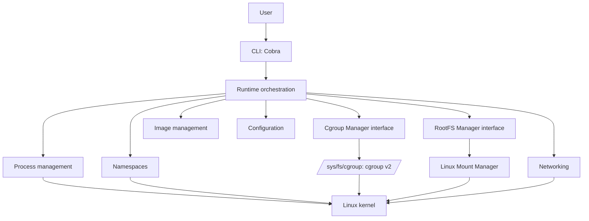

# Vellora

Vellora is an educational, OCI-inspired container runtime written in Go. It builds runtime concepts from first principles, with a modular design that makes each Linux subsystem understandable. It is not a Docker implementation.

> **Status:** early runtime milestones. On Linux, `vellora run` creates PID, UTS, mount, IPC, and network namespaces, can apply cgroups v2 memory/CPU/task limits, pivots into a supplied rootfs, and can mount an existing base layer through OverlayFS with a private writable upper. Vellora can import local OCI layouts and pull OCI images from registries. Pulled layers are retained as verified blobs but are not unpacked into a runnable rootfs. Networking currently provides a bridge, veth pairs, IPv4 allocation, routes, DNS configuration, and outbound masquerading. The process still uses the caller's credentials and capabilities; rootless operation and port publishing are not implemented.

## Architecture

The CLI translates user input into runtime requests. The runtime coordinates process and subsystem interfaces; subsystem packages own their respective kernel-facing concerns. Dependencies point inward, so subsystem packages never import the CLI. The namespace initializer is replaced with the requested program so the program becomes PID 1 inside the new PID namespace.



## Repository layout

```text
cmd/vellora/       executable entry point
internal/          private CLI, runtime, and subsystem packages
pkg/               future stable, reusable public libraries
api/               future API and schema definitions
configs/           example YAML configuration
docs/              design notes and architecture decisions
examples/           sample configs and usage
scripts/           development helpers
test/              integration and end-to-end fixtures
.github/           issue and pull request templates
```

The initially empty top-level directories reserve clear homes for future additions; implementation stays under `internal` until a stable public API is justified.

## Getting started

Requirements: Linux, Go 1.25 or newer, Make, `iproute2`, `iptables`, and sufficient privilege to create namespaces, mount procfs, configure links, enable forwarding, and install firewall rules. The CLI can be built on macOS, but Linux runtime operations require a Linux host or VM.

```sh
make build
sudo ./bin/vellora run --hostname vellora /bin/bash
```

`run` configures the default bridge network automatically. To create and inspect it explicitly, use `sudo ./bin/vellora network create`, `sudo ./bin/vellora network ls`, and `sudo ./bin/vellora network inspect vellora0`. See [container networking](docs/networking.md) for packet paths and verification.

Resource limits are optional. For example, `sudo ./bin/vellora run --memory=512M --cpu=1 --pids=64 -- /bin/bash` applies a 512 MiB memory ceiling, one CPU of bandwidth, and a 64 task limit. The host must expose the requested controllers to `/sys/fs/cgroup/vellora`; see [cgroups v2](docs/cgroups-v2.md) for setup and verification.

To run an existing base layer, place a populated root filesystem at `<image_path>/layers/<name>` and run `sudo ./bin/vellora run --rootfs alpine -- /bin/sh`. Vellora mounts a private OverlayFS upper over that shared lower, mounts private `/proc`, `/tmp`, and `/dev`, then pivots away from the host root. The upper is preserved after exit. See [root filesystem isolation](docs/rootfs.md) and [OverlayFS storage](docs/overlayfs.md).

Inside the shell, `echo $$` should print `1`; use `readlink /proc/self/ns/{pid,uts,mnt,ipc}` to inspect namespace identities. Without `--rootfs`, the shell retains the current host filesystem view inside its private mount namespace. See [namespace theory](docs/namespaces.md), [cgroups v2](docs/cgroups-v2.md), [rootfs isolation](docs/rootfs.md), and [OverlayFS storage](docs/overlayfs.md).

Local OCI Image Layouts can be imported and inspected with `vellora image import alpine:local /path/to/oci-layout`. Registry images can be downloaded with `sudo ./bin/vellora pull alpine:latest`; manifests and layer blobs are digest-verified and stored locally. Pulled layers are not unpacked yet, so running an image by name is not supported. See [local OCI image support](docs/oci-image-spec.md) and [registry support](docs/oci-registry.md).

## Development

```sh
make fmt
make test
make lint
make clean
```

Configuration is YAML; see [`configs/vellora.yaml`](configs/vellora.yaml). Runtime defaults are exposed in `internal/config`. Errors should retain context through wrapping, long-running operations should accept `context.Context`, and package loggers use `log/slog`.

Major design choices are recorded in [ADRs](docs/adr/).

## Roadmap

| Milestone | Scope |
| --- | --- |
| v0.1 | CLI, process lifecycle, Linux namespaces, cgroups v2 memory/CPU/pids limits, private rootfs |
| v0.2 | OverlayFS writable layers (existing local lower only), rootfs creation, container lifecycle |
| v0.3 | Bridge networking, veth pairs, IPv4 IPAM, outbound NAT (implemented; no port publishing) |
| v0.4 | Local OCI image support and registry image pulling (implemented; layer unpacking remains) |
| v0.5 | Volumes, logs, stats, inspect, exec |
| v1.0 | Reviewed security properties, stable interfaces, complete docs and tests |

## Future work

Each subsystem will be implemented incrementally behind its package boundary, with ADRs documenting the kernel primitive, alternatives, and tradeoffs. The first implementation milestones intentionally do not attempt to reproduce Docker's product surface.
