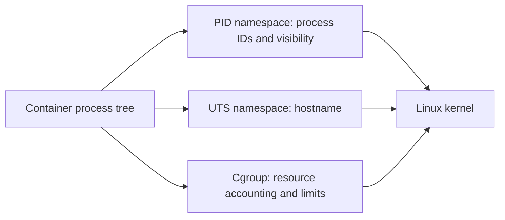
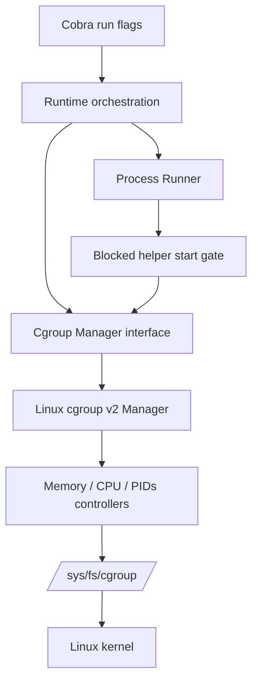

# Linux cgroups v2

This document explains the resource-control milestone in Vellora. The implementation supports hard memory limits, CPU bandwidth limits, and task-count limits for one `vellora run` process tree. It does not configure I/O or CPU-set policies.

## 1. What cgroups are

A **control group** (cgroup) is a kernel object that groups processes so the kernel can account for and constrain their resource use. Cgroups were introduced to make resource accounting and partitioning possible across groups of tasks: administrators can cap memory, allocate CPU bandwidth, or limit task creation without changing the application.

Namespaces and cgroups answer different questions:

| Mechanism | Question answered | Examples |
| --- | --- | --- |
| Namespace | What resources and identities can this process see? | PID 1 in its own PID namespace; a private hostname |
| Cgroup | How much of a shared resource may this process group consume? | At most 512 MiB; at most one CPU's bandwidth |

Containers commonly use both. Namespaces provide a view of isolation; cgroups account for and constrain consumption. Neither substitutes for the other. Vellora's cgroups feature does not create a security boundary by itself.



## 2. v1 and v2

Cgroups v1 evolved as several controller-specific hierarchies. Controllers could be mounted separately and the same process could appear in different directory trees for different controllers. That flexibility complicated delegation, administration, and consistent resource accounting.

Cgroups v2 uses a **unified hierarchy**: one cgroup tree represents process membership, and controllers expose their controls at each applicable node. The kernel presents it through a cgroup2 filesystem, commonly mounted at `/sys/fs/cgroup`. Vellora checks that its configured parent is on cgroup2 before creating groups.

Controller files appear only when the controller is available to that cgroup and enabled for child groups. `cgroup.controllers` lists controllers available to distribute; `cgroup.subtree_control` controls which are enabled for children. In v2, a non-root domain cgroup cannot contain processes and simultaneously distribute domain controllers to children (the **no-internal-process** rule). Vellora therefore uses an empty anchor cgroup (`/sys/fs/cgroup/vellora`) and places each workload in its own child directory.

The manager enables requested controllers at its own empty anchor. It does not rewrite the host's parent `cgroup.subtree_control` policy. If the controllers are not delegated, the kernel rejects the request; configure a suitable delegated cgroup root and make it available to Vellora.

## 3. Controllers

Controllers implement resource-specific accounting and policy in the kernel.

| Controller | Purpose | Common v2 controls |
| --- | --- | --- |
| `memory` | Memory use, reclaim, and pressure | `memory.max`, `memory.current`, `memory.high`, `memory.events` |
| `cpu` | CPU time accounting and bandwidth/relative weight | `cpu.max`, `cpu.weight`, `cpu.stat` |
| `pids` | Bounds task creation in a process group | `pids.max`, `pids.current`, `pids.events` |
| `io` | I/O accounting and per-device bandwidth/IOPS policy | `io.stat`, `io.max`, `io.weight` |
| `cpuset` | Which CPUs and NUMA nodes tasks may use | `cpuset.cpus`, `cpuset.mems`, effective variants |

Vellora currently implements only `memory`, `cpu`, and `pids`. I/O policy is about storage throughput/IOPS and is distinct from CPU or memory limits. Cpuset affinity restricts *where* tasks may run; it does not itself set a CPU-time quota.

## 4. cgroup v2 filesystem controls

The cgroup filesystem is a kernel API, not an ordinary disk directory. Reading a control file queries kernel state; writing a control file requests a policy change or process move. Permissions and controller availability are enforced by the kernel.

| File | Read meaning | Write meaning |
| --- | --- | --- |
| `memory.max` | Hard memory ceiling in bytes, or `max` | Set the hard ceiling. The kernel reclaims memory when possible; if usage cannot be reduced enough, allocation may fail and the cgroup OOM path may kill a task. |
| `memory.current` | Current memory charged to the cgroup and descendants, in bytes | Read-only accounting; writes are rejected. |
| `cpu.max` | `MAX PERIOD` in microseconds, or `max PERIOD` | Set quota and period. For example `50000 100000` allows 50 ms of aggregate CPU time per 100 ms period (one half of one CPU). |
| `cpu.weight` | Relative CPU weight (typically 1–10000; default 100) | Set a relative share under contention. This is not a hard cap and is not set by `--cpu`. |
| `pids.max` | Maximum number of tasks, or `max` | Set an admission limit on task creation. The count includes threads, not only process-group leaders. |
| `cgroup.procs` | PIDs of process leaders currently assigned to this cgroup | Writing a PID moves that process into this cgroup. Children inherit the membership. |

`memory.current` changes as charges are added and released. It is useful for observation, not policy. `cgroup.procs` is used internally by Vellora after creating a blocked helper process and before releasing it to execute the workload.

## 5. Resource policy details

### Memory and OOM behavior

`memory.max` is a hard memory limit. When a charge would exceed it, the kernel tries reclaim. If reclaim cannot bring usage below the limit, an allocation can fail or the memory cgroup's OOM handling can kill one or more tasks. This is separate from the host-wide OOM situation. It does not promise that the workload will gracefully receive a Go-style error; native applications may be terminated by `SIGKILL`.

The limit is in bytes. Vellora parses convenient binary suffixes (`512M`, `1GiB`) and writes the byte count. Memory charged can include more than a process's resident anonymous heap, depending on kernel accounting and configuration.

### CPU quota, period, and throttling

`cpu.max` is `quota period`, both in microseconds. The ratio `quota / period` is the aggregate CPU capacity in cores. Vellora uses a 100,000 μs period: `--cpu=1` writes `100000 100000`, while `--cpu=0.5` writes `50000 100000`.

When tasks use their quota before the period ends, the CPU controller **throttles** them until the next period. This bounds long-term CPU bandwidth; it does not pin the process to one particular CPU. `cpu.stat` exposes usage and throttling counters. Short bursts and scheduling granularity mean `top` samples need not show an exact instantaneous percentage.

### PID/task limit

`pids.max` limits the number of kernel tasks in the cgroup. A process that attempts `fork()` or `clone()` when the limit has been reached gets an error (typically `EAGAIN`); a shell may report “Resource temporarily unavailable.” Threads count too. The controller prevents new task creation but does not kill tasks that already exist when a limit is lowered.

## 6. Vellora architecture



`internal/cgroup` owns cgroup filesystem access behind a small `Manager` interface: `Create`, `AddProcess`, and `Remove`. `internal/runtime` depends on that interface, not cgroup file paths. The Linux implementation is build-tagged separately; other platforms return an explicit unsupported error.

The process runner starts the namespace helper and leaves it blocked on a pipe. Runtime writes its host PID to `cgroup.procs`, then releases the gate. This ordering prevents the requested command from running even briefly outside its limits. Once the process tree exits, runtime waits for the cgroup to become unpopulated, kills any remaining descendants with `cgroup.kill` when supported, and removes the per-run child directory. The empty `/sys/fs/cgroup/vellora` anchor remains for reuse.

### Run a workload

```sh
sudo ./bin/vellora run --memory=512M --cpu=1 --pids=64 -- /bin/bash
```

All limits are optional. `--memory` accepts bytes or K/M/G/T suffixes; `--cpu` accepts fractional cores; `--pids` is a positive task count. The requested controller must be exposed to the configured cgroup root. A failure to create or configure the cgroup is returned before the application executes.

## 7. Build and tests

```sh
make build
make test
make lint
```

Unit tests use temporary files to verify controller serialization and cover runtime ordering with fake process/cgroup implementations. Privileged kernel tests are opt-in and Linux-only:

```sh
sudo env PATH="$PATH" go test -tags=integration ./test/integration -run TestRunAppliesAndRemovesCgroupLimits -v
```

The integration test checks that the child is PID 1, observes all three cgroup control values, and that the temporary leaf cgroup disappears after exit. The host must provide cgroup v2, the CPU/memory/PID controllers, and permission to delegate them to `/sys/fs/cgroup/vellora`.

## 8. Manual verification

Build and start a constrained shell:

```sh
make build
sudo ./bin/vellora run --memory=512M --cpu=1 --pids=64 -- /bin/bash
```

In another host terminal, locate the cgroup path from the workload (or inspect `cgroup.procs` under the Vellora anchor):

```sh
sudo find /sys/fs/cgroup/vellora -maxdepth 2 -type f \( -name memory.max -o -name memory.current -o -name cpu.max -o -name cpu.stat -o -name pids.max -o -name pids.current -o -name cgroup.procs \) -print
sudo cat /sys/fs/cgroup/vellora/run-*/memory.max
sudo cat /sys/fs/cgroup/vellora/run-*/memory.current
sudo cat /sys/fs/cgroup/vellora/run-*/cpu.max
sudo cat /sys/fs/cgroup/vellora/run-*/cpu.stat
sudo cat /sys/fs/cgroup/vellora/run-*/pids.max
sudo cat /sys/fs/cgroup/vellora/run-*/pids.current
```

The `run-*` directory exists only while the workload is alive; it is removed at exit. `memory.max` should show `536870912`, `cpu.max` should show `100000 100000`, and `pids.max` should show `64`.

### Memory pressure

Install `stress-ng` using your distribution's package manager, then run it with an allocation larger than the cgroup limit:

```sh
sudo ./bin/vellora run --memory=128M -- /usr/bin/stress-ng --vm 1 --vm-bytes 256M --vm-keep --timeout 30s
```

The stressor cannot keep 256 MiB resident under a 128 MiB `memory.max`. It may be killed by the memory cgroup OOM handler; inspect `memory.events` before the cgroup is cleaned up if you need to observe `oom`/`oom_kill` counters. The exact exit code depends on stress-ng and kernel OOM behavior.

### CPU bandwidth

```sh
sudo ./bin/vellora run --cpu=0.5 -- /bin/sh -c 'yes > /dev/null & yes > /dev/null & wait'
```

Two busy loops together should be throttled to about half of one CPU over time. In `top` or `htop`, the total for the cgroup workload should be near 50% of one CPU under the conventional per-core display; `cpu.stat` should show throttling counters increasing. `ps -o pid,ppid,comm -C yes` lists the host-visible workload processes while they run. Stop the test with Ctrl-C.

### Task count

```sh
sudo ./bin/vellora run --pids=16 -- /bin/sh -c 'for i in $(seq 1 100); do sleep 30 & done; wait'
```

Only a limited number of task creations should succeed; later `fork` attempts fail at the kernel limit. `pids.current` stays at or below `pids.max` for normal creation. A fork bomb is not needed to verify the controller; use a bounded loop as above.

### Host setup and debugging

```sh
findmnt -t cgroup2
cat /sys/fs/cgroup/cgroup.controllers
cat /sys/fs/cgroup/cgroup.subtree_control
cat /sys/fs/cgroup/vellora/cgroup.controllers
cat /sys/fs/cgroup/vellora/cgroup.subtree_control
sudo journalctl -k --since '5 minutes ago' | grep -i -E 'memory|oom|cgroup'
```

If a controller is missing, check whether the parent has it available and whether the system's service manager has delegated a subtree. Do not blindly enable controllers at the global root on a managed host; use a delegated subtree appropriate for your service manager. `EOPNOTSUPP`, `EBUSY`, or permission errors usually mean the hierarchy/controller/delegation setup does not satisfy the kernel's rules. If a cgroup remains, inspect `cgroup.events` (`populated`) and `cgroup.procs`; a live descendant can keep it populated.

## 9. Performance and operational considerations

- CPU quota introduces periodic throttling; a shorter period can reduce burst latency but increases scheduling overhead. Vellora currently uses 100 ms for predictable, simple behavior.
- Memory limits can trigger reclaim and OOM handling, causing latency spikes or abrupt process termination. Leave headroom for caches, runtime support processes, and workload peaks.
- PID limits include threads. Set them with the workload's thread model in mind.
- Cgroup membership is inherited by children, so the one host PID moved by Vellora covers its descendant process tree.
- cgroup control files are kernel interfaces with controller-specific semantics; never treat them as ordinary configuration files or assume all files exist on every kernel.

## References

- [Linux kernel cgroup v2 documentation](https://docs.kernel.org/admin-guide/cgroup-v2.html)
- [Linux `cgroups(7)` manual](https://man7.org/linux/man-pages/man7/cgroups.7.html)
- [Docker Engine security overview](https://docs.docker.com/engine/security/)
- [containerd runtime v2 documentation](https://github.com/containerd/containerd/blob/main/docs/runtime-v2.md)
