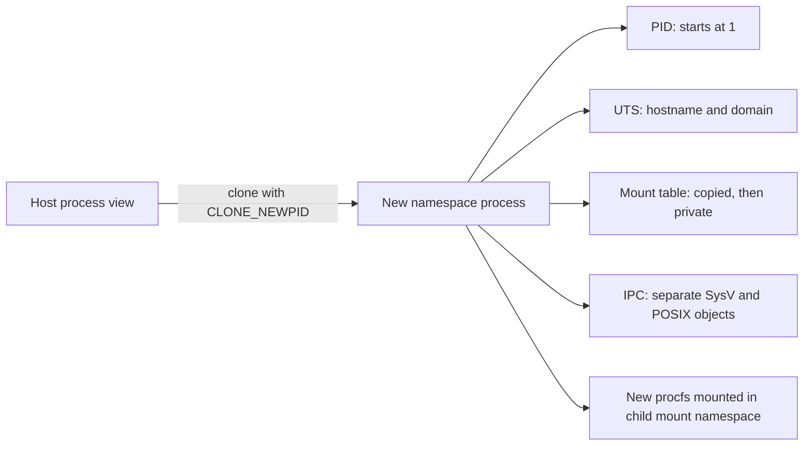

# Linux namespaces in Vellora

This document describes the first `vellora run` slice. It creates a process in new PID, UTS, mount, and IPC namespaces. It does **not** create a new root filesystem: the process still sees the host's filesystem tree, although its mount table and `/proc` mount are private. Run only trusted commands.

## What namespaces do

A Linux namespace changes a process's view of a kernel resource. Namespaces let Linux provide container-like isolation without booting another kernel. They are one part of containerization; this milestone does not provide filesystem confinement, resource limits, networking, or a security boundary suitable for untrusted workloads.

### Linux namespace types

| Namespace | Resource view | Clone flag | This milestone |
| --- | --- | --- | --- |
| PID | Process IDs and process visibility | `CLONE_NEWPID` | Yes |
| Mount | Mount table and propagation | `CLONE_NEWNS` | Yes |
| Network | Network devices, routes, ports, and protocol stacks | `CLONE_NEWNET` | No |
| IPC | System V IPC and POSIX message queues | `CLONE_NEWIPC` | Yes |
| UTS | Hostname and NIS domain name | `CLONE_NEWUTS` | Yes |
| User | UID/GID mappings and capabilities | `CLONE_NEWUSER` | No |
| Cgroup | View of the cgroup hierarchy | `CLONE_NEWCGROUP` | No |
| Time | Monotonic and boottime clock offsets | `CLONE_NEWTIME` | No |

The table lists Linux's eight namespace types. A kernel can lack a namespace feature or prohibit creation through its security policy; compile support alone does not guarantee runtime permission. See [`namespaces(7)`](https://man7.org/linux/man-pages/man7/namespaces.7.html).

Docker uses namespaces and cgroups when starting Linux containers. Containerd commonly delegates low-level task creation to an OCI runtime such as runc; the OCI Linux configuration names namespace types such as `pid`, `mount`, `ipc`, and `uts`. Vellora is learning the kernel primitives behind those choices rather than implementing Docker's product or API surface. See the [Docker security overview](https://docs.docker.com/engine/security/), [containerd runtime architecture](https://github.com/containerd/containerd/blob/main/docs/runtime-v2.md), and [OCI runtime specification](https://github.com/opencontainers/runtime-spec).



The launcher remains in the host namespaces and waits for a helper child. That child becomes PID 1 in the new PID namespace, configures its namespace-local state, and calls `execve` to replace itself with the requested program. The `execve` step preserves the child PID.

## Process creation and PID namespace

`fork(2)` creates a child process that continues from the caller's point of execution. Linux commonly uses copy-on-write pages, so parent and child initially share physical memory until one writes. `execve(2)` replaces the calling process's program image without creating a process, so its PID remains the same. `clone(2)` is Linux's configurable process-creation primitive; flags choose which resources the child shares and whether it enters new namespaces.

```text
vellora launcher (host namespace; waits for child)
└── namespace helper (host PID e.g. 4200; child PID 1)
    └── execve("/bin/bash") replaces helper; PID stays 4200/1
```

Go's `os/exec` starts the helper. Its Linux `syscall.SysProcAttr.Cloneflags` field asks Go's process-creation path to pass namespace flags. `CLONE_NEWPID` applies to the child: the caller remains in its current PID namespace, while the new child sees itself as PID 1.

PID 1 is the namespace's init process. It adopts orphaned children, and when it exits, Linux kills remaining processes in that PID namespace. This scaffold replaces the helper with the requested program, so that program is PID 1. A command that forks children should handle signals and reap children. A later runtime may add a small init supervisor, but that changes whether the requested process itself is PID 1.

```text
Host PID namespace                  Child PID namespace
vellora (launcher)                  /bin/bash (PID 1)
  └── helper (host PID 4123)  ---->    └── child sees its own PID as 1
```

An existing procfs mount is associated with the PID namespace active when it was mounted. Therefore Vellora's storage manager mounts a fresh procfs after entering the PID and mount namespaces. Without that step, `getpid()` could report 1 while `/proc` and tools such as `ps` still showed the host's PID view.

## UTS namespace: hostname and `uname`

### PID 1, signals, and zombie processes

When a process exits but its parent has not called `wait(2)`, it remains a zombie: the kernel keeps its PID and exit status so the parent can collect it. If a parent exits first, Linux reparents its orphaned children to the namespace init process (or a nearer subreaper). Therefore PID 1 must reap children. Linux also restricts which signals can be delivered to a namespace's PID 1; an init-style program should install handlers and forward signals appropriately. Since Vellora execs the requested command as PID 1, that command owns these responsibilities.

The UTS namespace contains the hostname and NIS domain name returned by `uname(2)`. `CLONE_NEWUTS` starts with copies of the parent's values. `sethostname(2)` changes only the child namespace's hostname. Go's standard library exposes general system information through `syscall.Uname`; Vellora uses `golang.org/x/sys/unix.Sethostname` to set the hostname.

Use `--hostname` to set the initial value, or change it from a privileged shell inside the namespace. This project does not create a user namespace, so the process relies on host capabilities. Creating these namespaces normally requires root or `CAP_SYS_ADMIN`.

## Mount namespace, propagation, and bind mounts

`CLONE_NEWNS` creates a separate mount table initialized as a copy of the parent's mount table. It does not automatically provide a different filesystem root.

Mount propagation controls whether mount and unmount events travel between related mount trees:

- **Shared** mounts propagate events to peer mounts.
- **Slave** mounts receive events from a master but do not send them back.
- **Private** mounts do not propagate events in either direction.

Vellora's Linux storage manager calls `mount(2)` with `MS_REC|MS_PRIVATE` on `/`. `MS_REC` applies the propagation change recursively to submounts; `MS_PRIVATE` prevents events from leaking across the namespace boundary. The call is intentionally made only in the new mount namespace.

A bind mount uses `MS_BIND` to attach an existing file or directory at another path. With `--rootfs`, Vellora mounts the existing layer through OverlayFS, then bind-mounts the merged tree onto itself and uses `pivot_root(2)` to install it as `/`. The detailed procedure and writable-layer behavior are in [rootfs isolation](rootfs.md) and [OverlayFS storage](overlayfs.md).

The new procfs mount uses `mount(2)` with source and type `proc` and restrictive flags (`MS_NOSUID|MS_NODEV|MS_NOEXEC`). It changes the child mount table only.

## IPC namespace

`CLONE_NEWIPC` isolates System V IPC identifiers and objects, including shared memory segments, semaphore sets, and message queues. It also isolates POSIX message queue state. A process in this namespace cannot discover or use the host's IPC objects through the namespace's IPC interfaces.

The kernel creates the IPC namespace as part of the child process creation; this milestone does not need a separate setup syscall.

## Go implementation map

- `internal/cli/run.go` parses `run` options and constructs a process spec.
- `internal/runtime/runtime.go` coordinates the request through an injected `process.Runner`.
- `internal/process/process_linux.go` configures `exec.Cmd.SysProcAttr.Cloneflags`.
- `internal/namespace/namespace_linux.go` maps the requested set to `CLONE_NEWPID`, `CLONE_NEWUTS`, `CLONE_NEWNS`, and `CLONE_NEWIPC`, then sets the hostname.
- `internal/storage/manager_linux.go` makes mounts private, pivots into an optional rootfs, and mounts procfs and private tmpfs filesystems.
- `internal/process/exec_linux.go` calls `unix.Exec`, replacing the helper process with the requested command while preserving its PID.
- `internal/*_other.go` files keep the project buildable off Linux and return an explicit unsupported error at runtime.

`context.Context` is passed to `exec.CommandContext`, so cancellation terminates the child. Standard input, output, and error are connected to the invoking terminal. Errors are wrapped at each package boundary.

`os/exec.Cmd` holds the executable, arguments, environment, working directory, and standard streams. `Cmd.Run` starts and waits for that command; `exec.CommandContext` connects context cancellation to the child process. Linux's `syscall.SysProcAttr` is attached to `Cmd.SysProcAttr`, and its `Cloneflags` field contains the ORed `CLONE_NEW*` bits.

`golang.org/x/sys/unix` supplies Linux syscall wrappers not offered as portable APIs by `os/exec`: `unix.Sethostname` invokes `sethostname(2)`, `unix.Mount` invokes `mount(2)`, and `unix.Exec` invokes `execve(2)`. Vellora can create namespaces from Go because Go's Linux process launcher accepts clone flags and the child can call Linux syscalls before it executes the workload.

## Run and verify on Linux

Build and run from a Linux host or VM. This workspace's development host is macOS, which cannot create Linux namespaces.

On the host shell, record its PID and hostname before starting Vellora:

```sh
echo "host shell PID=$$"
hostname
host_hostname=$(hostname)
```

```sh
make build
sudo ./bin/vellora run --hostname vellora /bin/bash
```

The required separator form is also supported:

```sh
sudo ./bin/vellora run -- /bin/bash
sudo ./bin/vellora run -- /usr/bin/env
sudo ./bin/vellora run -- /bin/sh
```

Inside the shell:

```sh
echo "PID=$$"
readlink /proc/self/ns/pid
readlink /proc/self/ns/uts
readlink /proc/self/ns/mnt
readlink /proc/self/ns/ipc
hostname
ps -ef
```

Expected: `$$` is `1`; namespace links differ from the host's corresponding `/proc/self/ns/*` links; `ps` shows processes from the new PID namespace. The host's hostname remains unchanged after running `hostname vellora` inside the shell. Check the host hostname in another terminal before and after.

The host shell's `$$` is its ordinary host PID, while the requested command sees PID `1` inside the child PID namespace. After changing the container hostname, return to the host shell and verify `test "$(hostname)" = "$host_hostname"`.

### Mount verification

Inside the container, mount tmpfs and create a marker:

```sh
mkdir -p /tmp/vellora-mount-check
mount -t tmpfs tmpfs /tmp/vellora-mount-check
touch /tmp/vellora-mount-check/inside-only
```

On the host, the directory may exist because the filesystem tree is shared, but the marker must not:

```sh
test ! -e /tmp/vellora-mount-check/inside-only && echo "mount is private"
```

After exiting the container, remove the now-empty host directory with `rmdir /tmp/vellora-mount-check`.

### IPC verification

In one terminal, create a System V shared-memory segment and keep the namespace alive:

```sh
sudo ./bin/vellora run -- /bin/sh -c 'ipcmk -M 4096; sleep 30'
```

Note the printed shared-memory ID. In another host terminal, run `ipcs -m -i <shared-memory-id>`. The host IPC namespace should report that the ID is invalid or absent. Exit or stop the container shell afterward; the namespace-owned segment is cleaned up with the namespace.

### Automated Linux integration tests

On Linux with root privileges or equivalent capabilities, plus `mount`, `ipcmk`, and `ipcs` installed:

```sh
sudo env PATH="$PATH" go test -tags=integration ./test/integration -v
```

These opt-in tests check PID 1, namespace inode separation, hostname isolation, mount-marker invisibility, and System V shared-memory invisibility.

To verify from another terminal while the shell is running, inspect the namespace links for the host-visible child PID shown by `ps -ef` on the host:

```sh
readlink /proc/<host-pid>/ns/pid
readlink /proc/<host-pid>/ns/uts
readlink /proc/<host-pid>/ns/mnt
readlink /proc/<host-pid>/ns/ipc
```

Exit the shell with `exit`. Since it is PID 1 in the child namespace, the namespace's remaining processes are terminated by the kernel.

## Debugging

- **`operation not permitted`:** run with sufficient privilege and check whether the host/container allows `CAP_SYS_ADMIN` and these namespace types.
- **`mount procfs: ...`:** confirm the configured proc mountpoint exists in the supplied rootfs (or on the current root when `--rootfs` is omitted) and that procfs mounts are permitted.
- **`ps` shows host processes:** confirm the child has a new PID namespace and that the fresh procfs mount succeeded.
- **Hostname changed on host:** do not use the internal helper directly; invoke `vellora run`, which creates a UTS namespace before setup.
- **Mount changes appear on host:** Vellora must set recursive private propagation before mounting procfs. Check that the run path created a mount namespace.
- **The shell starts then everything exits:** a PID namespace's init process is essential. If PID 1 exits, the kernel kills the namespace's remaining processes.
- **`unshare -m` test:** compare `findmnt -o TARGET,PROPAGATION /` on the host and inside the child; the child's tree should not be shared with the host.

## Limitations and next improvements

Without `--rootfs`, the command retains the current filesystem tree. With `--rootfs`, path lookup starts in the merged view of the named base layer and a private writable upper. In both cases the process still inherits host credentials and capabilities; see [rootfs security limitations](rootfs.md#8-security-and-limitations). Signal and exit-status handling can be improved; a tiny init process can reap orphaned children if the design later prioritizes that behavior over the requested command being PID 1.

## References

- [`fork(2)`](https://man7.org/linux/man-pages/man2/fork.2.html), [`execve(2)`](https://man7.org/linux/man-pages/man2/execve.2.html), [`clone(2)`](https://man7.org/linux/man-pages/man2/clone.2.html)
- [`namespaces(7)`](https://man7.org/linux/man-pages/man7/namespaces.7.html), [`pid_namespaces(7)`](https://man7.org/linux/man-pages/man7/pid_namespaces.7.html), [`mount_namespaces(7)`](https://man7.org/linux/man-pages/man7/mount_namespaces.7.html)
- [`uts_namespaces(7)`](https://man7.org/linux/man-pages/man7/uts_namespaces.7.html), [`ipc_namespaces(7)`](https://man7.org/linux/man-pages/man7/ipc_namespaces.7.html), [`wait(2)`](https://man7.org/linux/man-pages/man2/wait.2.html)
- [Go `os/exec`](https://pkg.go.dev/os/exec), [Go `syscall.SysProcAttr`](https://pkg.go.dev/syscall#SysProcAttr), [`golang.org/x/sys/unix`](https://pkg.go.dev/golang.org/x/sys/unix)
