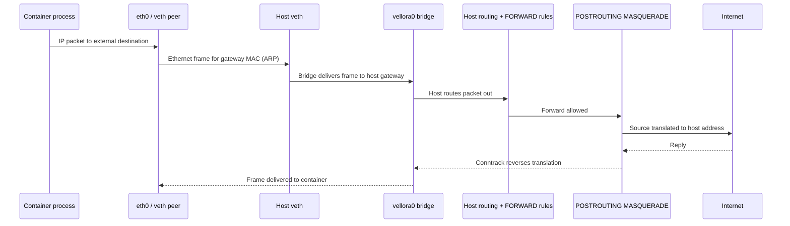
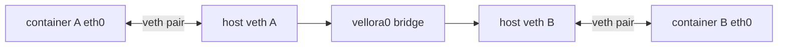

# Vellora container networking

This milestone gives each container a Linux network namespace, a veth endpoint, an address from a persistent private pool, a route through a host bridge, and outbound IPv4 masquerading. The implementation is deliberately small and Linux-only.

## Linux building blocks

### Network namespaces

A network namespace owns a separate set of network devices, addresses, routes, neighbor (ARP) entries, firewall state, and network sysctls. A process created with `CLONE_NEWNET` starts with its own loopback device and no ordinary host interfaces. Capabilities are evaluated in the relevant user namespace; this milestone runs with host privileges and does not implement rootless/user-namespace operation.

### Ethernet, ARP, and the bridge

Ethernet frames carry a source and destination MAC address on one layer-2 segment. IPv4 hosts use ARP to discover the MAC address associated with a next-hop IPv4 address. Linux bridge `vellora0` learns MAC-to-port associations and switches frames between attached veth host endpoints. The bridge receives `10.88.0.1/16`, so the host has a directly connected route for the container subnet.

Docker's conventional `docker0` follows this same basic shape: a host bridge acts as the containers' layer-2 segment and gateway. Vellora uses `vellora0` by default; its name and subnet are configurable.

### veth pairs

A veth pair behaves like a virtual Ethernet cable. A frame sent at one end appears at the other. Vellora attaches the host end to the bridge and moves the peer into a container's network namespace, where it is renamed `eth0`.

### Routing, forwarding, and NAT

The container has an address such as `10.88.0.2/16` and a default route via `10.88.0.1`. The bridge is the host-side gateway. Linux IPv4 forwarding allows the host to route packets between interfaces. The Vellora-owned `iptables` chains accept outbound forwarding and established return traffic. A `POSTROUTING` MASQUERADE rule rewrites the container source address to the host's egress address; conntrack remembers the mapping so replies can be translated back.

`iptables` is the command interface used by this milestone. On many current distributions it is backed by nftables (`iptables-nft`), but this is not the same as programming nftables directly. Vellora only edits its own named chains and does not flush global tables. Existing host firewall policy can still block forwarding, and administrator firewall managers can reorder or remove rules.

## Packet paths

### Container to the Internet



### Container to container



For two addresses on `10.88.0.0/16`, the sender ARPs for the destination directly. The bridge switches the frame to the peer port; IP forwarding/NAT is not needed for that same-subnet path. Host-to-container traffic uses the host's connected route through `vellora0`.

## Architecture

```text
CLI (`run`, `network`)
          |
          v
runtime.Manager ---- NetworkManager interface
          |                    |
          |             +------+----------------------+
          |             | IPAM | bridge | veth | NAT  |
          |             | route + namespace config    |
          |             +-----------------------------+
          |                    |
          +-- gated helper     +-- ip / sysctl / iptables
               CLONE_NEWNET            |
               configures eth0         v
               before exec          Linux kernel
```

The runtime only coordinates `Prepare`, `Connect`, and `Disconnect`. Linux command execution is isolated behind `internal/network/command`; bridge, veth, namespace, firewall/NAT, IPAM, route, and DNS responsibilities live in their own packages. The start gate prevents the workload from running until the host has moved the veth peer into its namespace and joined any configured cgroup.

### Startup and teardown

```text
allocate address + resolver file
       -> start helper with CLONE_NEWNET (helper waits)
       -> ensure bridge + forwarding + NAT
       -> create veth; attach host end; move peer to helper PID
       -> release helper
       -> raise lo; rename peer eth0; set address/MTU/default route
       -> bind a read-only resolver file (when a rootfs is supplied)
       -> exec workload
       -> delete host veth; release address; remove resolver file
```

The bridge is intentionally left in place when an individual container exits. `vellora network rm` removes it after all persisted IP allocations have been released.

## Address management

The default pool is `10.88.0.0/16`; `.1` is reserved for the bridge gateway. The allocator skips the network address, gateway, broadcast address, and all persisted allocations. Allocation state is JSON under `<runtime_root>/network/ipam.json`; an advisory file lock serializes multiple Vellora processes, and a temporary file plus rename prevents partial JSON state. Releasing an address makes it available for reuse.

Configure defaults in YAML:

```yaml
runtime_root: /var/lib/vellora
network_bridge: vellora0
network_subnet: 10.88.0.0/16
network_gateway: 10.88.0.1
# Empty means discover a non-loopback IPv4 nameserver from /etc/resolv.conf.
network_dns: ""
network_mtu: 1500
```

Choose a subnet that does not overlap with host LAN, VPN, cloud, or other container networks. This implementation currently supports IPv4 only.

## Commands

Host networking commands require Linux, the `ip`, `sysctl`, and `iptables` programs, and privileges sufficient to create links, configure addresses, and edit firewall rules:

```sh
sudo vellora network create
vellora network ls
vellora network inspect vellora0
sudo vellora run -- /bin/sh
sudo vellora run --rootfs ./examples/alpine -- /bin/sh
sudo vellora network rm vellora0
```

`vellora run alpine` is not yet an image-name invocation: image layers are not unpacked and connected to run by this milestone. Supply an executable or a supported `--rootfs` tree. DNS is set up by a resolver bind mount when a root filesystem is supplied; an empty rootfs uses the mount namespace's existing `/etc/resolv.conf`.

## Troubleshooting and verification

On the host, inspect devices, bridge ports, forwarding, routes, and firewall rules:

```sh
ip addr show vellora0
ip -d link show vellora0
bridge link
ip route
sysctl net.ipv4.ip_forward
iptables -t nat -S VELLORA_NAT
iptables -t filter -S VELLORA_FORWARD
cat /proc/net/arp
```

Inside a running container, inspect its independent namespace:

```sh
ip addr
ip route
ip neigh
cat /etc/resolv.conf
ping -c 2 10.88.0.1
ping -c 2 8.8.8.8
getent hosts example.com
curl -I https://example.com
```

For host-to-container testing, leave a process running and use its host PID:

```sh
sudo nsenter -t "$PID" -n ip addr
ping -c 2 10.88.0.2
```

Common failures:

- `operation not permitted`: run with the capabilities needed for network namespaces, link configuration, sysctls, and firewall changes.
- `RTNETLINK answers: File exists`: check for a conflicting bridge, address, route, or stale host veth; do not delete unfamiliar host links blindly.
- No Internet traffic: inspect `net.ipv4.ip_forward`, forwarding policy, Vellora chains, the host's egress route, and any firewall manager that rewrites rules.
- IP allocation fails: inspect `ipam.json` for stale allocations left by a process crash.
- DNS fails while IP ping works: check the configured resolver address and whether it is reachable from the container subnet. Host-local stub resolvers such as `127.0.0.53` cannot be used directly in another network namespace.
- Container-to-container fails: verify both host veth ports appear in `bridge link`, both containers use the configured subnet, and the bridge is up.

## Operational limits

- Linux and IPv4 only. No port publishing, IPv6, policy routing, DHCP, DNS proxy, firewall manager integration, rootless mode, or automatic crash reconciliation.
- Network configuration is applied by invoking `ip`, `sysctl`, and `iptables` without a shell. The required binaries must be installed and in `PATH` or configured through the Go API.
- IP allocation survives restarts, but a hard crash can leave stale veths and allocations; inspect before manually releasing state. Normal process exit runs teardown.
- Forwarding is enabled globally and remains enabled after bridge removal. Existing host policy and security settings must be considered by the operator.
- The fallback DNS server is `8.8.8.8` when host resolver discovery fails; set `network_dns` for environments where that resolver is not appropriate or reachable.

## References

- [Linux network namespaces](https://man7.org/linux/man-pages/man7/network_namespaces.7.html)
- [Linux veth devices](https://man7.org/linux/man-pages/man4/veth.4.html)
- [Linux bridge documentation](https://docs.kernel.org/6.9/networking/bridge.html)
- [Linux IP sysctls, including forwarding](https://docs.kernel.org/networking/ip-sysctl.html)
- [iptables manual](https://man7.org/linux/man-pages/man8/iptables.8.html)
- [nftables project documentation](https://netfilter.org/projects/nftables/manpage.html)
