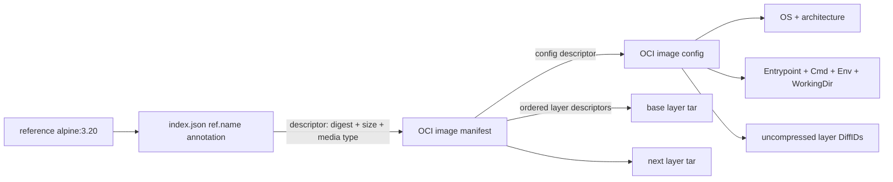

# Local OCI image support

Vellora can import, validate, list, resolve, inspect, and delete references to images from an **existing local OCI Image Layout**. It does not contact a registry, download layers, unpack archives, or change the current `run --rootfs` behavior. `run --rootfs <name>` still uses a prepared directory under `<image_path>/layers/<name>`; bridging OCI layers into that tree belongs to a later unpack/rootfs milestone.

## What OCI is

The Open Container Initiative (OCI) is an open standards project under the Linux Foundation. It was announced in 2015 by container ecosystem companies to establish interoperable container formats and runtime behavior. Its image-format, runtime, and distribution specifications solve different problems.

| Term | Responsibility | Vellora today |
| --- | --- | --- |
| Docker image | An image produced or managed by Docker tooling. Modern Docker tooling can handle OCI formats, but Docker has also used Docker-specific schema/media types and archive conventions. | Vellora accepts OCI Image Layout content and OCI image media types, not Docker archives or legacy manifest formats. |
| OCI image | A manifest/index, config, and ordered filesystem layer changesets described by content-addressed descriptors. | Locally imported and inspected. |
| OCI runtime | Creates and starts a process from runtime configuration while applying OS isolation. | Vellora's namespaces, cgroups, rootfs, and OverlayFS work are runtime concerns; a full OCI Runtime Specification bundle is not implemented here. |
| OCI Distribution | HTTP API and content exchange between clients and registries. | Not implemented. No Docker Hub or registry communication occurs. |

OCI describes an image as an image manifest, optional image index, config, and filesystem layers. The layout defines how those content objects are organized on disk. See the [OCI Image Specification](https://github.com/opencontainers/image-spec/blob/main/spec.md) and the [OCI project's 2015 announcement](https://opencontainers.org/posts/announcements/2015-06-20-industry-leaders-unite-to-create-project-for-open-container-standard/).

## OCI Image Layout

An OCI layout root has this basic shape:

```text
oci-layout-root/
├── oci-layout                 # layout version marker
├── index.json                 # named references and manifest descriptors
└── blobs/
    └── sha256/
        ├── <digest>           # image index or manifest JSON blob
        ├── <digest>           # image config JSON blob
        └── <digest>...         # ordered layer tar blobs
```

- **`oci-layout`** is required JSON with `imageLayoutVersion`, currently `1.0.0` for the layout parser in this milestone.
- **`index.json`** is the entry point. Its `manifests` array contains descriptors. A descriptor annotation named `org.opencontainers.image.ref.name` commonly supplies a tag. A descriptor may point directly to a manifest or to another index, such as a multi-platform index.
- **`blobs/<algorithm>/<encoded>`** stores opaque content by digest. For `sha256:<hex>`, the blob path is `blobs/sha256/<hex>`. The bytes must hash to the referenced digest; the layout specification requires this content-addressed naming.
- **`manifest.json` and `config.json`** are not normally fixed root-level OCI layout files. They are useful conceptual names for the JSON objects, and Docker archive formats may include such filenames. In an OCI layout, the image manifest and image config are blobs under `blobs/sha256/` and are found through descriptors.

The configured Vellora image store is separate from a source OCI layout:

```text
<image_path>/
├── blobs/sha256/     # imported immutable manifest, config, and layer bytes
├── metadata/         # validated image summaries keyed by manifest digest
├── refs/             # local tag -> manifest digest records
├── cache/            # reserved for future derived metadata
└── layers/           # prepared rootfs directories used by the OverlayFS milestone
```

`image_path` is already configurable in `configs/vellora.yaml`. Importing an OCI layout writes to `blobs`, `metadata`, and `refs`; it does not unpack those blobs into `layers`.

## Manifest, config, and layers



An **image manifest** identifies one platform image. It has a schema version, its media type, a config descriptor, and an ordered `layers` array. Descriptors carry `mediaType`, `digest`, and `size`; Vellora validates all three before using a descriptor. Layer order is meaningful: applying the ordered changesets yields the root filesystem.

An **image config** is separate from the runtime's eventual `config.json`. It identifies the image's `os` and `architecture`, describes `rootfs.type` and ordered `rootfs.diff_ids`, and carries image execution defaults such as `Entrypoint`, `Cmd`, `Env`, `WorkingDir`, `User`, and labels. OCI expects `rootfs.type` to be `layers`.

A **layer** is a tar-based filesystem changeset. Common OCI media types include:

| Media type | Bytes |
| --- | --- |
| `application/vnd.oci.image.layer.v1.tar` | uncompressed tar |
| `application/vnd.oci.image.layer.v1.tar+gzip` | gzip-compressed tar |
| `application/vnd.oci.image.layer.v1.tar+zstd` | zstd-compressed tar |

OCI also defines nondistributable layer variants. Vellora stores supported OCI layer blobs exactly as received; it does not extract them or need a decompressor in this milestone.

### Layer digest and DiffID are different

The manifest layer **digest** identifies the exact blob bytes. If a tar is compressed, this hashes the compressed bytes. The config's **DiffID** identifies the uncompressed tar stream. Vellora validates descriptor digests and sizes for the manifest, config, and every imported layer. It validates DiffID syntax, count, and order, but does not recompute DiffIDs because that requires decompressing the layer (and zstd support is not included). The OCI config specification makes this distinction explicit: [Image Config and DiffID](https://github.com/opencontainers/image-spec/blob/main/config.md#layer-diffid).

## SHA-256, digests, and immutability

For SHA-256, Vellora streams bytes through `crypto/sha256`, encodes the 32-byte result as 64 lowercase hexadecimal characters, and compares the result with `sha256:<hex>`. It also compares the raw byte count with descriptor `size`. The descriptor digest verifies content integrity; it does **not** prove who created or signed the image.

An image's content is immutable in the content-addressed model: changing a manifest, config, or layer changes its digest and therefore changes the object identity. A **tag** is mutable metadata that names a manifest digest. For example, `alpine:latest` can be moved to a newer manifest while old blobs remain valid and addressable. The config digest is sometimes called an ImageID; it is not the same value as the manifest digest or a layer digest.

Vellora supports SHA-256 descriptors only. It rejects malformed or unsupported digest algorithms rather than resolving arbitrary algorithm names into filesystem paths. OCI descriptors and media types are specified in [descriptor.md](https://github.com/opencontainers/image-spec/blob/main/descriptor.md) and [media-types.md](https://github.com/opencontainers/image-spec/blob/main/media-types.md).

## References and platform indexes

The parser accepts a local `name[:tag][@sha256:digest]` form. An omitted tag resolves as `latest`. OCI index annotations are location-addressable references; the immutable object identity is its digest. When an index points to nested platform manifests, Vellora selects the current host's `GOOS/GOARCH` descriptor and validates its platform against the config when the index supplies platform metadata. There is no registry name lookup or network fallback.

## Package boundaries

```text
internal/image/                 domain models and subsystem interfaces
├── layout/                     oci-layout + index parsing and descriptor traversal
├── manifest/                   manifest schema, parser, and blob loader
├── config/                     OCI image config parser and validation
├── layer/                      ordered layer discovery + LayerStore implementation
├── store/                      local content store, metadata, refs, import/list/delete
├── reference/                  name/tag/digest parsing
└── validator/                  digest, descriptor, and stream verification
```

The root `image` package defines `ImageStore`, `ImageResolver`, `LayerStore`, `ManifestLoader`, and `ReferenceParser` interfaces. Concrete readers and stores depend on these small domain types; CLI commands depend on the store API. `slog` records image loading, manifest reads, digest checks, reference resolution, and discovered layers.

The local store imports verified objects into a temporary blob file, syncs it, and atomically renames it into the content-addressed path. Reference records use a hash of the canonical reference as their filename, avoiding user-controlled path components. Deleting a tag removes its ref and unreferenced metadata; blobs remain because layers and manifests can be shared and this milestone has no garbage collector.

## Kernel relationship

OCI image data is userspace content, not a kernel container primitive. The kernel does not parse an OCI manifest or apply an image config. A runtime translates image defaults into process arguments/environment and turns ordered layer changesets into a root filesystem. Vellora currently stops after local validation and metadata inspection: it does not convert the image config into an OCI Runtime Specification bundle, unpack tar entries, build a lower layer, or mount the imported OCI layers with OverlayFS. Namespaces, cgroups, mounts, and process execution remain the kernel-facing work done by the runtime.

## Commands and examples

Import an **already existing** OCI layout from disk:

```bash
vellora image import alpine:local /path/to/oci-layout
```

List imported references with either supported form:

```bash
vellora images
vellora image ls
```

Inspect the same local reference:

```bash
vellora inspect alpine:local
vellora image inspect alpine:local
```

The JSON inspection output includes manifest/config digests, OS, architecture, entrypoint, command, environment, working directory, user, labels, and the ordered layer descriptor list. Use `--config path/to/vellora.yaml` on each command to select a non-default `image_path`.

No `pull` command is implemented. The existing `pull` name remains scaffolded and does not communicate with Docker Hub or any registry.

## Tests and limits

Tests cover reference parsing, layout validation, manifest/config parsing, digest and size mismatches, layer ordering, importing, alias tags, listing, inspection, and deletion. The store is local and SHA-256-only. It supports OCI image manifests and indexes, but does not support Docker archives, Docker schema-2 manifests, signatures, referrers/artifacts, foreign network URLs, zstd DiffID recomputation, garbage collection, unpacking, or registry access.

The image index and manifest formats are defined by the [OCI Image Layout](https://github.com/opencontainers/image-spec/blob/main/image-layout.md), [Image Manifest](https://github.com/opencontainers/image-spec/blob/main/manifest.md), [Image Config](https://github.com/opencontainers/image-spec/blob/main/config.md), and [Media Types](https://github.com/opencontainers/image-spec/blob/main/media-types.md) documents.
