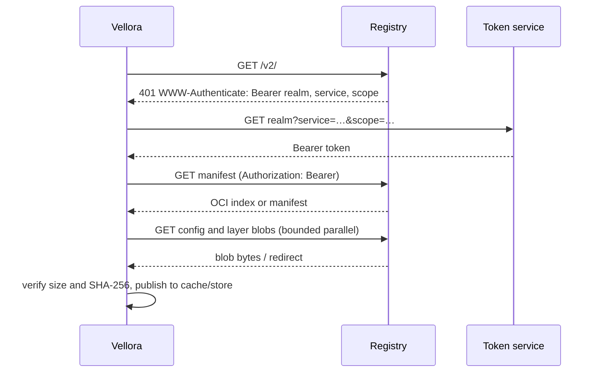

# OCI Registry Client

## OCI Distribution and registry API

The OCI Image Specification defines image manifests, configs, indexes, descriptors, and layer media types. The OCI Distribution Specification defines HTTP operations to move those objects between a client and registry. Vellora uses the Registry HTTP API v2 endpoints adopted by OCI Distribution: `GET /v2/`, `GET /v2/<repository>/manifests/<tag-or-digest>`, and `GET /v2/<repository>/blobs/<digest>`.



OCI Distribution is distinct from container networking. These requests are outbound HTTP client traffic; they do not configure a container bridge, veth pair, NAT, or any network namespace behavior. The registry API follows HTTP semantics and may redirect requests. The Go HTTP client follows redirects, and Go strips sensitive authorization headers when redirecting to a different host.

## References, tags, and digests

`alpine:latest` is a repository plus mutable tag. A pull resolves that name to an immutable manifest. The manifest digest, config digest, and layer digests identify exact bytes using SHA-256 descriptors. The client checks descriptor sizes and SHA-256 before a cache file is published or the local image store accepts it. `Docker-Content-Digest`, when present on a manifest response, is also checked against the response body.

Unqualified Docker Hub names use `registry-1.docker.io`; one-component repositories are expanded under `library/`. Other references can include an explicit registry host, for example `ghcr.io/owner/image:tag`. The default platform is the host OS and architecture. `--platform os/architecture[/variant]` selects another platform when the registry index contains it.

## Manifest and content model

An image manifest references one config object and an ordered set of layer blobs. OCI image manifests and Docker schema 2 manifests are supported, as are OCI indexes and Docker manifest lists. An index points to manifests with platform descriptors; Vellora chooses the host platform before fetching the config and layers.

Layer blob digests cover the compressed bytes transported by the registry. Config `rootfs.diff_ids` cover uncompressed layer streams and are validated for format and count; Vellora does not decompress layers in this milestone. A layer is immutable by its digest, so images with common layers share local blob files.

## Authentication

The client first pings `/v2/`. If the registry returns a Bearer challenge, Vellora parses `realm`, `service`, and `scope`, requests a token, caches it until expiry, then retries the registry request. Anonymous token requests are supported. Optional username/password credentials are read from the `auths` entries in `$DOCKER_CONFIG/config.json` or `~/.docker/config.json`; Docker credential-helper executables are not invoked. Tokens and passwords are not logged.

Registries use HTTPS by default. For a development-only local registry, explicitly allow its host:

```bash
vellora pull --insecure-registry 127.0.0.1:5000 127.0.0.1:5000/alpine:test
```

## Blob download, caching, and recovery

The registry cache lives under `runtime/images/cache/registry/sha256/`; the local image store owns canonical blobs under `runtime/images/blobs/sha256/`. The downloader deduplicates requests by digest, takes a per-digest filesystem lock, and limits concurrent downloads (default four, maximum sixteen). Existing local blobs are verified and reused before a request is made. Downloaded files are streamed to a partial file, checked against the descriptor, synced, then atomically renamed into the cache. The image store verifies again when installing the blob.

Transient network errors and HTTP 408, 429, 500, 502, 503, and 504 responses are retried with backoff. If a transfer ends early, its partial file is preserved and the next attempt uses an HTTP `Range` request. A valid `206 Content-Range` must start at the exact saved offset and report the descriptor's total size; a server that ignores Range and returns `200` causes the partial to restart from zero. Digest or size mismatches are rejected and the bad partial is removed.

The cache allows a later pull to reuse verified content. The local image store then persists manifest/config/layer metadata and a local tag reference, so inspecting or pulling that reference again does not require registry access. Cache and blob files are content-addressed, so identical layers are not stored twice in the canonical blob store.

## CLI

```bash
vellora pull alpine
vellora pull ubuntu:22.04
vellora pull --platform linux/arm64 alpine:latest
vellora images
vellora inspect alpine
find runtime/images/blobs/sha256 -type f
```

Use `--config path.yaml` for a custom `image_path`. `pull` prints the imported image metadata as JSON; structured log messages report manifest fetches, authentication, cache hits/misses, and verified blob progress.

## Limits in this milestone

- OCI image manifests and Docker schema 2; legacy Docker schema 1 is not supported.
- SHA-256 descriptors only.
- Host-platform selection from a single-level index/list.
- Docker config `auths` credentials; credential helpers and identity tokens are not implemented.
- Registry pulls do not unpack layers or connect them to `vellora run`; layer extraction and runtime integration remain separate work.
- No push, catalog listing, referrers, signatures, or registry-side cache controls.

## Debugging

Check the response's media type, manifest descriptor digest, and blob descriptor size first. Then inspect the local paths:

```bash
vellora images
vellora inspect alpine
find runtime/images/cache/registry -type f
find runtime/images/blobs/sha256 -type f
```

`401` errors point to a challenge/token or credential issue; `404` usually means the repository or tag is wrong; digest and size errors indicate corrupted or incorrectly described content. For a private registry, verify that its challenge supplies a reachable token realm and a pull scope for the repository.

## References

- [OCI Distribution Specification](https://github.com/opencontainers/distribution-spec/blob/main/spec.md)
- [OCI Image Specification media types](https://github.com/opencontainers/image-spec/blob/main/media-types.md)
- [OCI Image Index Specification](https://github.com/opencontainers/image-spec/blob/main/image-index.md)
- [Docker Registry Bearer token authentication](https://distribution.github.io/distribution/spec/auth/token/)
