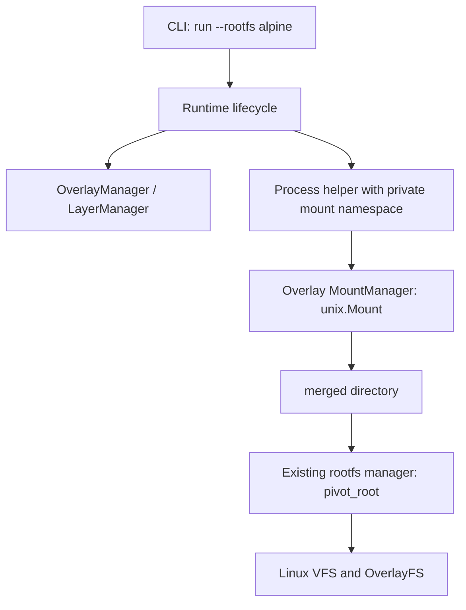

# OverlayFS storage

Vellora uses the Linux OverlayFS filesystem to present a shared, existing base layer with a private writable directory for each container. This milestone does not pull, unpack, identify, or delete images. A layer named by `--rootfs` must already exist as a directory under `<image_path>/layers/`.

## Why image layers exist

Applications often use the same base operating-system files. Storing that content once and reusing it saves disk space and avoids copying a complete root filesystem for every container. An image is conceptually an ordered set of changes; this milestone starts with one populated lower directory and leaves image construction and multi-layer composition for a later milestone.

```text
                     container process sees /
                               │
                         merged mount
                      ┌────────┴────────┐
            per-container upper      shared lower
              new/changed files    existing base tree
                      │
                   workdir
             OverlayFS temporary state
```

Each container has a unique `upper`, `work`, and `merged`. Multiple overlays may share the same lower. Sharing upper or work directories between simultaneously mounted overlays is unsupported and can produce undefined behavior.

## Copy-on-write and merged lookups

For reads, OverlayFS searches upper first and then lower. If both contain directories, it presents their directory entries as a merged directory. The first write or metadata change to a lower-only file triggers **copy-up**: OverlayFS copies that file and required metadata into upper, then performs the operation on the upper copy. Vellora does not copy files itself.

Deleting a lower-only path cannot alter shared lower content. OverlayFS records a **whiteout** in upper to hide the matching lower name. It records an opaque-directory marker when an upper directory must hide the corresponding lower directory contents. These are kernel-managed metadata, not ordinary files users should edit.

The base layer is not physically immutable: the host can still modify its directory. Vellora treats it as immutable by policy while overlays use it. Mutating backing directories while mounted is unsupported by OverlayFS and can make cached views stale. A future image manager should enforce read-only access and coordinate layer deletion with persistent leases.

## OverlayFS, AUFS, and Btrfs

- **OverlayFS** is an in-kernel union filesystem with read-only lower directories and a writable upper/work pair. It is the current implementation because it is in the mainline kernel and fits the one-base-plus-private-writes model.
- **AUFS** is another union filesystem with a branch model and a long history in container deployments. It has generally been distributed out of tree, so it is not a portable kernel assumption.
- **Btrfs** is a copy-on-write filesystem with subvolumes and cheap snapshots. It can make excellent container storage, but requires a Btrfs backing store and uses filesystem-native snapshots rather than combining arbitrary directory trees.

## Kernel and backing filesystem requirements

The kernel must support OverlayFS (`CONFIG_OVERLAY_FS`, built in or available as a module) and the caller needs mount privileges (`CAP_SYS_ADMIN` in the relevant user namespace; this milestone assumes a privileged Linux host). The upper filesystem must support valid `d_type` directory entries and the extended attributes OverlayFS needs. Upper and work must be on the same filesystem; work must be empty. The lower is treated as read-only by the overlay. Some filesystem types and kernel configurations reject an upper directory or specific features. Vellora relies on the mount syscall’s error rather than enabling optional features such as `metacopy`, `redirect_dir`, `index`, or `xino` without compatibility checks.

Linux kernel documentation: [Overlay Filesystem](https://docs.kernel.org/filesystems/overlayfs.html).

## Linux mount API and flags

The legacy `mount(2)` syscall attaches a filesystem to a target path in the caller’s mount namespace. Vellora invokes the Go wrapper `unix.Mount(source, target, filesystemType, flags, data)` from `internal/storage/overlay`, never from runtime orchestration. The overlay mount has filesystem type `overlay` and options shaped like:

```text
lowerdir=/var/lib/vellora/images/layers/alpine,
upperdir=/run/vellora/containers/<id>/upper,
workdir=/run/vellora/containers/<id>/work
```

Vellora validates names and absolute paths and rejects commas, colons, backslashes, and newlines in paths because the legacy option string uses delimiters. Newer kernel mount APIs can pass some paths without this limitation; adopting them can be a later improvement.

| Flag | Kernel effect | Vellora use |
| --- | --- | --- |
| `MS_NODEV` | Device-special files on this mount are not interpreted as devices. | Applied to merged root. |
| `MS_NOSUID` | Set-user-ID/set-group-ID bits and file capabilities are ignored when executing files from this mount. | Applied to merged root. |
| `MS_NOEXEC` | Programs cannot be executed from this mount. | Explained but deliberately not applied to the root: `/bin/sh` must execute there. |

These are mount restrictions, not a complete security boundary. Linux `mount(2)` documentation describes their precise behavior: [mount(2)](https://www.man7.org/linux/man-pages/man2/mount.2.html).

## Go APIs used

- `golang.org/x/sys/unix` exposes Linux syscalls and constants, including `unix.Mount`, `unix.Unmount`, `unix.Stat`, and OverlayFS flags. It keeps syscall errors available for `%w` wrapping and `errors.Is` checks.
- `filepath.Join` builds host paths using platform separators; `filepath.Abs`, `EvalSymlinks`, and `Rel` help canonicalize and constrain a named layer. Joining alone does not prevent traversal.
- `os.MkdirAll` creates the parent runtime directory. Vellora then uses exclusive `os.Mkdir` for a new container ID so it never reuses or deletes an existing container’s upper layer.
- `os.RemoveAll` recursively deletes. It is used only for a freshly created partial container directory after preparation fails, and for the owned empty `merged` mountpoint after the child mount namespace has exited. It is never used on lower or upper.
- `filepath.Walk` visits a tree recursively; `filepath.WalkDir` is its newer, more efficient alternative. Neither is needed to validate every file in a trusted, pre-populated lower tree; walking large images at startup would add needless latency. The manager validates the layer root and required rootfs mountpoint directories instead.

## Vellora architecture and lifecycle



`internal/storage/overlay` exposes `OverlayManager`, `LayerManager`, and `MountManager`. Runtime asks the manager to resolve a layer, acquire a reference, and create owned directories. It passes the canonical paths to the hidden process initializer. The initializer first changes `/` to recursively private (`MS_REC|MS_PRIVATE`) in the child’s mount namespace; only then does it mount OverlayFS. This order prevents mount events from following inherited shared propagation relationships into the host. The existing rootfs manager then pivots into `merged` and mounts `/proc`, `/tmp`, and `/dev`. Runtime code has no mount syscall.

The kernel unmounts namespace-local mounts when the namespace’s last process exits. The parent then removes the empty `merged` mountpoint and releases its reference. `upper` is preserved so filesystem changes persist; the unique `work` directory also remains and must be empty once the kernel mount is gone. A subsequent `run` creates a new container ID, so persistent container lifecycle/reuse is not yet implemented.

The current reference counter is in-process. There is no image deletion command today, so no cross-process deletion race exists in the supported CLI. Before implementing layer deletion or parallel persistent container management, replace this with durable leases and stale-lease recovery.

## Storage layout and setup

`runtime_root` and `image_path` are configured in `configs/vellora.yaml` (or another YAML file). The manager derives:

```text
<image_path>/layers/<layer-name>/       existing lower tree
<runtime_root>/containers/<random-id>/
    upper/
    work/
    merged/
```

Prepare an existing rootfs tree with at least `/bin/sh`, `/proc`, `/tmp`, and `/dev`:

```bash
sudo mkdir -p /var/lib/vellora/images/layers/alpine
# Populate that directory with a Linux root filesystem using your chosen local tooling.
sudo vellora run --rootfs alpine -- /bin/sh
```

`--rootfs` is a **layer name**, not an arbitrary path. No registry or image download occurs.

## Verification

Inside the container:

```sh
findmnt /
grep ' / ' /proc/mounts
touch /etc/vellora-overlay-check
cat /etc/vellora-overlay-check
```

On the host, use the `upper` path printed in Vellora’s structured log (or inspect the matching random directory under `runtime_root/containers`):

```bash
findmnt -t overlay
cat /proc/mounts | grep overlay
cat /var/lib/vellora/images/layers/alpine/etc/os-release
find /run/vellora/containers -path '*/upper/etc/vellora-overlay-check' -print
```

The container’s overlay mount is private to its mount namespace and disappears when the container exits, so host `findmnt -t overlay` may show no entry after exit. The marker should exist in the container’s `upper/etc/` while it is running and remain there after exit; the lower file remains unchanged. To inspect a live mount, run `findmnt /` and `cat /proc/mounts` inside the container.

## Tests

Run unit tests on Linux with:

```bash
go test ./internal/storage/overlay ./internal/runtime
go test ./test/integration -run OverlayFS
```

The integration test performs a real mount and may skip when OverlayFS or mount capability is unavailable. Unit coverage checks layer-name/path containment, directory ownership, mount argument wiring, and cleanup preserving upper. macOS can compile the project but cannot run Linux mount integration tests.

## Performance and limitations

Read-only base data is shared without duplicating it. Files are copied only when a write or metadata change needs an upper copy; repeated reads and writes then use the selected underlying file. First-write latency and upper storage growth depend on file size, metadata, and backing filesystem. Large files can incur significant copy-up cost. Directory enumeration merges names and has caching semantics; workloads should not assume arbitrary host-side mutations to backing trees instantly appear.

Known milestone limits: one lower directory, no image download/unpack, no layer deletion, no persistent container ID or `rm` lifecycle, no rootless operation, no optional OverlayFS tuning, no automatic crash recovery, and no protection against a privileged host administrator changing the lower tree.

### Debugging common failures

- `unknown filesystem type 'overlay'` or `ENODEV`: kernel support/module is missing.
- `operation not permitted`: the process lacks mount capability or is running in a restricted environment.
- `invalid argument`: inspect the kernel log (`dmesg`) for upper filesystem/feature errors and verify the mount options.
- `workdir ... is not empty` or `upperdir and workdir must reside under the same mount`: use a fresh empty work directory on the upper’s filesystem.
- `device or resource busy`: check for stale mounts with `findmnt` and confirm no other active overlay uses the same upper/work paths.
- Copy-up doesn’t appear where expected: inspect the upper path while the container is running; remember that copy-up only occurs for writes or metadata operations.

References: [Linux OverlayFS documentation](https://docs.kernel.org/filesystems/overlayfs.html), [mount(2)](https://www.man7.org/linux/man-pages/man2/mount.2.html), and [`unix.Mount`](https://pkg.go.dev/golang.org/x/sys/unix#Mount).
