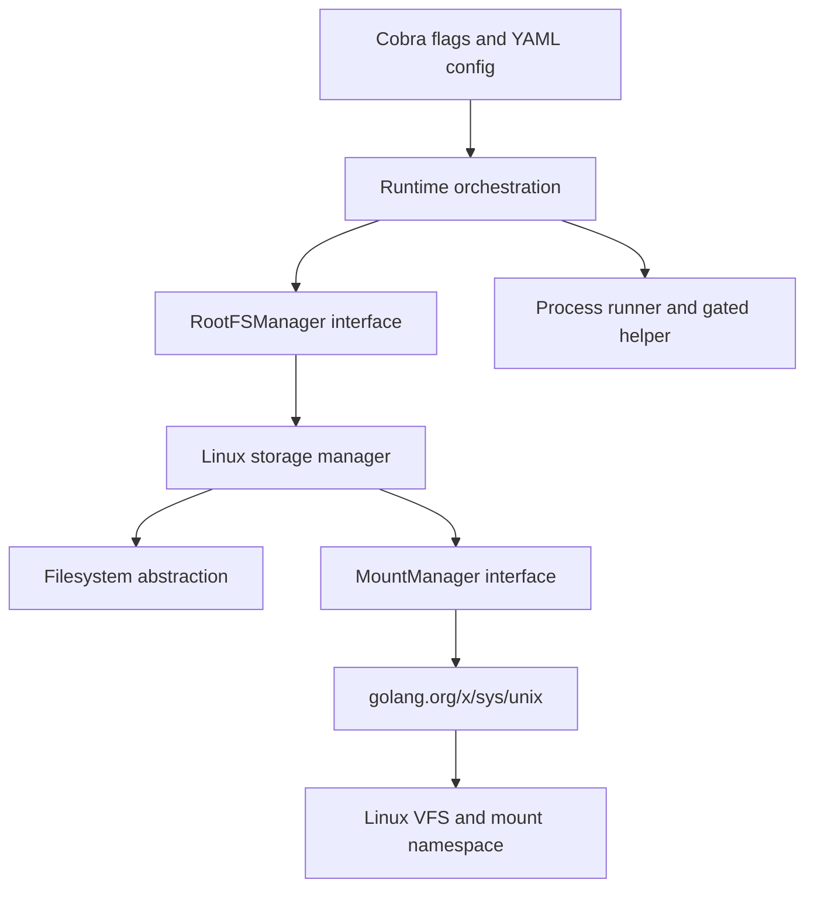

# Private root filesystems

Vellora can start a command with an existing base layer as `/`:

```sh
sudo ./bin/vellora run --rootfs alpine -- /bin/sh
```

The layer must already be a populated Linux root filesystem with the requested executable and its libraries at `<image_path>/layers/alpine`. Vellora does not download images or create layers. OverlayFS presents the shared lower with a private upper for writes; `/tmp`, `/dev`, `/dev/pts`, and `/dev/shm` are private mounts. See [OverlayFS storage](overlayfs.md) for the upper/work/merged lifecycle.

## 1. VFS and path lookup

The Linux **Virtual Filesystem Switch (VFS)** presents a common interface for filesystems such as ext4, tmpfs, procfs, and sysfs. A pathname is resolved relative to a process's root and working directory through the mount tree visible in its mount namespace. Thus `/etc/hosts` is not a global object: processes can resolve that same string to different inodes and mounts.

A mount point attaches a filesystem tree at a directory. Mount namespaces isolate the mount table, but a new mount namespace starts with a copy of the parent's mount tree. It does not start empty. Mount propagation controls whether mount and unmount events flow between mounts that share peer relationships:

| Type | Propagation behavior |
| --- | --- |
| Shared | Events flow to and from peer mounts. |
| Private | Events do not flow into or out of the mount. |
| Slave | Receives events from its master but does not send events back. |
| Unbindable | Private and cannot be bind-mounted. |

Vellora applies `MS_REC | MS_PRIVATE` to `/` inside the newly created mount namespace. `MS_REC` applies the operation to descendant mounts too. This prevents a later `/proc` or tmpfs mount from appearing in the host mount namespace. Kernel mount namespace propagation is documented in [`mount_namespaces(7)`](https://man7.org/linux/man-pages/man7/mount_namespaces.7.html).

```mermaid
flowchart LR
  Host[Host mount namespace: /] -->|clone mount table| Child[New mount namespace: initial copy]
  Child -->|MS_REC + MS_PRIVATE| Private[Private mount tree]
  Private -->|bind + pivot_root| Root[Supplied rootfs becomes /]
  Root --> Proc[/proc: procfs for container PID namespace]
  Root --> Tmp[/tmp: private tmpfs]
  Root --> Dev[/dev: private tmpfs and selected devices]
```

## 2. Rootfs, initramfs, and the root transition

A **root filesystem** is the directory tree a process sees at `/`. It can come from a disk filesystem, a memory filesystem, a directory tree, or a layered filesystem. The kernel's **initramfs** is an early root filesystem unpacked into memory during boot; the initial userspace uses it to load drivers and mount the eventual system root. This is a useful example of Linux booting with one root tree and then switching to another.

`chroot(path)` changes the root directory used in pathname lookup. It is useful for controlled build environments, but it does not change the mount tree or detach the old root. Open file descriptors and current working directories can still refer outside the new root, and a privileged process can escape a weak chroot setup. **chroot alone is not a container security boundary.**

`pivot_root(new_root, put_old)` changes the root mount in the current mount namespace. The old root is moved underneath `put_old`; Vellora then changes to `/` and lazily detaches the old mount. This removes the old root from the container's reachable mount tree. `new_root` must be a mount point, so Vellora first bind-mounts the supplied directory onto itself. The parent mounts must not remain shared when pivoting. See [`pivot_root(2)`](https://man7.org/linux/man-pages/man2/pivot_root.2.html).

Early container implementations often used `chroot` as a basic root-directory technique. Docker initially used LXC for container execution and later developed `libcontainer`/runc-based execution. It is inaccurate to summarize Docker's history as “Docker used only chroot”; modern container root setup is a sequence of namespace, mount, root-transition, and policy operations. Docker's own history describes its initial LXC execution environment and later runtime transition ([Docker and LXC](https://www.docker.com/blog/lxc-vs-docker/)); its old `libcontainer` source shows a `pivot_root` path ([archived rootfs implementation](https://github.com/docker-archive/libcontainer/blob/master/rootfs_linux.go)).

## 3. Mount operations Vellora uses

| Operation | Kernel effect in this milestone |
| --- | --- |
| `mount("", "/", "", MS_REC | MS_PRIVATE, "")` | Makes the copied mount tree private recursively. |
| `mount(rootfs, rootfs, "", MS_BIND, "")` | Makes the supplied directory a mount point so it can become the new root. This is a non-recursive bind; nested host submounts are not imported. |
| `pivot_root(".", ".")` | After changing directory to rootfs, stacks the old root at `/` and installs rootfs as the new root. This documented form needs no temporary directory in the supplied tree. |
| `chdir("/")` | Ensures relative path lookup starts at the newly installed root. |
| `umount2(".", MNT_DETACH)` | Detaches the stacked old root from the namespace's mount tree. Existing references can drain; new path lookups cannot reach it. |
| bind remount with `MS_RDONLY` | Makes a directly supplied root tree read-only when requested by the rootfs manager. The OverlayFS path leaves the merged root writable; the lower remains unchanged because OverlayFS copies changes to upper. |
| `mount("proc", "/proc", "proc", ...)` | Creates procfs after entering the PID namespace, so process IDs reflect the container. |
| tmpfs mounts | Provide private writable temporary directories and a small `/dev` without bind-mounting the host's full device tree. |

`umount2`'s `MNT_DETACH` is a lazy detach. The mount disappears from path lookup immediately, while references held by processes can be released later. See [`mount(2)`](https://man7.org/linux/man-pages/man2/mount.2.html) and [`umount(2)`](https://man7.org/linux/man-pages/man2/umount.2.html).

Go uses `golang.org/x/sys/unix` for Linux syscall wrappers: `unix.Mount` accepts the same source, target, filesystem type, flags, and data as `mount(2)`; `unix.PivotRoot` invokes the root transition; and `unix.Unmount` wraps `umount2`. `os.Chdir` changes the helper's working directory. `filepath.Abs`, `filepath.Clean`, and `filepath.EvalSymlinks` resolve and validate the caller's host-side rootfs path before the helper starts. Path cleaning is string/path handling, not a substitute for kernel mount permissions or race-free file-descriptor path resolution.

## 4. procfs, sysfs, devtmpfs, and /dev

- **procfs** is a process and kernel information interface. It is mounted after `CLONE_NEWPID` takes effect because the PID namespace association is fixed when procfs is mounted. Mounting the host procfs view would expose the wrong process list.
- **sysfs** exposes kernel devices and subsystem objects. It can reveal host information and should not be mounted casually. Vellora does not mount sysfs in this milestone.
- **devtmpfs** is a kernel-managed device-node filesystem commonly used for the host `/dev`. Mounting the host's complete devtmpfs would expose many host devices. Vellora instead mounts a private tmpfs and creates a small configured character-device allowlist (`null`, `zero`, `full`, `random`, `urandom`, and `tty` by default).
- **devpts** is mounted as a new instance at the configured pts path. `/dev/ptmx` points to that instance. `/dev/shm` receives a private tmpfs for POSIX shared-memory files.

This is a minimal runtime device set, not a full device-management system. Some workloads need additional devices, `/sys`, `/run`, or writable configuration paths; those are intentionally not supplied automatically here.

## 5. Architecture and implementation flow



The parent runtime calls `OverlayManager.Prepare` to resolve the named lower layer, acquire an active reference, and create unique upper/work/merged directories. It passes these paths to the re-executed helper. The helper first waits until the parent has placed it in its cgroup, then mounts OverlayFS in its private mount namespace, validates the merged rootfs, and calls `RootFSManager.Enter`. Runtime never calls mount syscalls directly.

Inside `Enter`, the Linux manager:

1. Makes inherited mounts recursively private.
2. Bind-mounts the supplied tree onto itself. This makes it a mount point, as required by `pivot_root`.
3. Changes directory to the bind mount and calls `pivot_root`.
4. Changes to `/` and detaches the stacked old root with `MNT_DETACH`; this form does not create a staging file or directory in the source tree.
5. Applies the rootfs read-only policy when requested. Overlay-backed runs remain writable at the merged mount and rely on OverlayFS to keep the lower unchanged.
6. Mounts procfs, tmpfs for `/tmp`, and a private `/dev` tmpfs with configured devices, devpts, and `/dev/shm`.
7. Replaces the helper process with the requested command using `exec`.

The `Filesystem` interface isolates directory, symlink, device-node, and `chdir` operations. The `MountManager` interface isolates mount, pivot, and unmount calls. Unit tests can therefore check ordering and rollback without requiring mount privileges.

### Configuration

The rootfs path can be passed on the CLI. Mount targets and tmpfs sizes are configured through YAML:

```yaml
rootfs_path: ""
storage:
  proc_mount: /proc
  tmp_mount: /tmp
  dev_mount: /dev
  pts_mount: /dev/pts
  shm_mount: /dev/shm
  tmp_size: 64m
  dev_size: 16m
  shm_size: 64m
```

Use `--config path/to/vellora.yaml` to load these values. The shipped example is [`configs/vellora.yaml`](../configs/vellora.yaml). Device nodes can also be configured under `storage.devices` with a name, permission mode, major number, and minor number.

## 6. Testing

Unit tests verify mount ordering, read-only remount, config validation, and rollback order using injected filesystem/mount abstractions:

```sh
make test
```

The privileged Linux integration test builds a static probe lower layer, runs it through `vellora run --rootfs`, checks that its working directory is `/`, verifies that a host-only path is absent, confirms writes land in upper while lower stays unchanged, and checks that `/tmp` changes do not persist:

```sh
sudo env PATH="$PATH" go test -tags=integration ./test/integration -run TestRunUsesPrivateOverlayRootFS -v
```

The integration test requires Linux, mount/PID/UTS/IPC namespace capabilities, and permission to mount procfs, tmpfs, and devpts.

## 7. Manual verification

Use a populated Linux rootfs that contains `/bin/sh` and all required shared libraries. Capture the host working directory and mount tree first:

```sh
pwd
findmnt -R /var/lib/vellora/images/layers/alpine
mount | head
```

Run a shell:

```sh
sudo ./bin/vellora run --rootfs alpine -- /bin/sh
```

Inside the container:

```sh
pwd                    # /
ls -la /
findmnt -R /
cat /proc/1/mountinfo
test ! -e /tmp/vellora-host-only-marker
echo private > /tmp/vellora-rootfs-check
echo changed > /etc/vellora-rootfs-check  # succeeds into this container's upper layer
```

The container should list files from the lower and upper plus mounted proc/tmp/dev filesystems. The host-only marker outside that tree should be absent. Writing beneath `/etc` should succeed in upper without changing lower, while `/tmp` writes disappear when the container exits.

On the host after exit:

```sh
findmnt -t overlay
find /run/vellora/containers -path '*/upper/etc/vellora-rootfs-check' -print
```

The host mount table should not contain the container's overlay, procfs, or tmpfs mounts after the helper exits. The rootfs lower is intentionally supplied by the caller; Vellora does not copy it. OverlayFS keeps writes in upper and the `pivot_root(".", ".")` form creates no old-root staging path in the lower tree.

## 8. Security and limitations

Mount isolation prevents path lookup through the container's mount tree from reaching the host root after the old root is detached. It is one part of isolation, not a complete security boundary. Vellora does not yet create a user namespace, drop capabilities, install seccomp filters, establish a network namespace, or enforce a device policy beyond constructing this private `/dev`. The command currently runs with the caller's credentials and inherited capabilities; run untrusted workloads only after adding and reviewing those controls.

The OverlayFS lower is shared and treated as immutable; each run writes to its own persistent upper. `/tmp`, `/dev`, `/dev/shm`, procfs, and the overlay mount are tied to the container mount namespace. When the process namespace exits, the kernel releases its mount tree; setup failures explicitly roll back rootfs mounts already created, and an initializer failure exits the helper so the namespace can be discarded.

## References

- [Linux `pivot_root(2)` manual](https://man7.org/linux/man-pages/man2/pivot_root.2.html)
- [Linux `mount(2)` manual](https://man7.org/linux/man-pages/man2/mount.2.html)
- [Linux `umount(2)` manual](https://man7.org/linux/man-pages/man2/umount.2.html)
- [Linux `mount_namespaces(7)` manual](https://man7.org/linux/man-pages/man7/mount_namespaces.7.html)
- [Linux path resolution](https://man7.org/linux/man-pages/man7/path_resolution.7.html)
- [Docker and LXC history](https://www.docker.com/blog/lxc-vs-docker/)
- [Archived Docker libcontainer rootfs implementation](https://github.com/docker-archive/libcontainer/blob/master/rootfs_linux.go)
