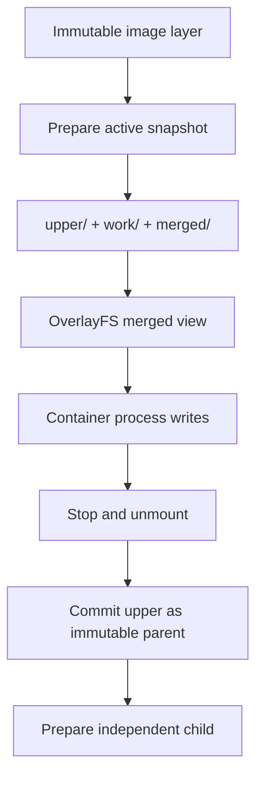

# Snapshot Management

## Snapshotter architecture

A snapshot is a managed filesystem state with a parent, lifecycle status, references, and paths. It is not the same thing as an image layer. An image layer is an immutable distribution artifact (usually a tar stream); a snapshot is a local filesystem representation managed by the runtime. A filesystem is the merged tree visible to a process. An image is config plus ordered immutable layers. A container is a process and its runtime resources, which may use a snapshot.



Containerd snapshotters expose lifecycle operations such as prepare, commit, mount, and remove. The snapshotter owns durable metadata and relationships; the runtime consumes mount descriptions. Vellora follows that separation: `Snapshotter` coordinates operations, `SnapshotStore` persists metadata, `SnapshotCleaner` removes filesystem trees, and a platform mount adapter performs OverlayFS syscalls.

## Lifecycle and OverlayFS

`Prepare(id, parent)` creates an active snapshot under `runtime/snapshots/<id>/` with `upper/`, `work/`, `merged/`, and `metadata.json`. The parent is either an absolute base-layer directory or an already committed snapshot ID. `Mount` mounts OverlayFS on `merged/`. `Unmount` detaches that mount. `Commit` is allowed only after unmount and treats the snapshot's upper directory as immutable so children can use it as a lower layer.

```text
runtime/
└── snapshots/
    ├── snap-a/
    │   ├── upper/       # delta for this snapshot
    │   ├── work/        # OverlayFS internal work area, same filesystem as upper
    │   ├── merged/      # mounted view while active
    │   └── metadata.json
    └── snap-b/          # independent writable child of snap-a
```

For a child of a committed snapshot, OverlayFS receives the committed upper directories from newest to oldest, followed by the original base layer. Copy-on-write sends modifications into only the child's upper directory. Sibling snapshots therefore share read-only lower content and do not share writes.

## References and garbage collection

Metadata's reference count records child and active mount references. A child increments its parent's count; deleting the child releases that reference. Mounting an active snapshot adds a reference and sets `mounted`; unmounting removes it. Deletion refuses nonzero references and snapshots with children. Basic garbage collection removes only snapshots with a zero reference count that have no children.

This conservative behavior is intentional for recovery: after a crash, Vellora preserves a persisted mount reference instead of assuming the mount disappeared. The metadata can be inspected and an operator can recover the mount state before removing the snapshot. A production daemon would use leases and mount-namespace-aware reconciliation to determine stale references safely; this CLI milestone does not guess.

## CLI and debugging

```bash
vellora snapshot ls
vellora snapshot inspect snap-a
vellora snapshot rm snap-a
find runtime/snapshots -maxdepth 3 -type f -o -type d
mount | grep overlay
findmnt -t overlay
```

Set `runtime_root` in the YAML config to choose the storage root, then pass `--config` to each command. Snapshot commands list, inspect, and remove; preparation and mounting are currently exposed through the Go `Snapshotter` interface for runtime integration.

For a Linux lifecycle exercise, create a base directory and populate a file, then in a small Go caller prepare two snapshots with that base as parent, mount each in an appropriately privileged private mount namespace, and write different values to the same path. The base remains unchanged and each snapshot sees its own value. `findmnt` should show the merged mount while mounted. This host's macOS environment cannot perform that Linux mount verification.

## Crash and cleanup behavior

Metadata updates use temporary files and atomic rename. Directory creation rolls back if preparation fails. A crash can still leave an incomplete directory before metadata is committed, or stale mount state. The implementation never deletes referenced snapshots automatically; it also does not implement cross-process locking, orphan-directory reconciliation, or privileged mount discovery. Those require a daemon or explicit recovery command before being safe to automate.

## Performance considerations

Snapshots avoid duplicating unchanged lower data. Reads traverse OverlayFS's lower chain, so deep ancestry increases lookup cost and OverlayFS limits the practical number/size of lower paths. Keep committed chains shallow through future compaction or layer squashing. `upper/` and `work/` must be on the same filesystem. The mount adapter uses `nodev` and `nosuid`; it does not enable networking, image pulling, volumes, or a registry.

## References

- [containerd snapshotter documentation](https://github.com/containerd/containerd/blob/main/docs/snapshotters/README.md)
- [Linux OverlayFS documentation](https://docs.kernel.org/filesystems/overlayfs.html)
- [OCI Image Specification](https://github.com/opencontainers/image-spec)
